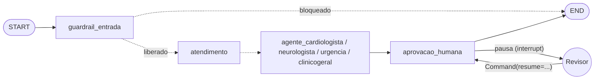

# Human in the loop: aprovação humana do parecer

Este documento explica como o susia pausa o fluxo para um profissional aprovar ou rejeitar o parecer do agente: o conceito, as peças de código envolvidas e o que acontece, passo a passo, em cada execução.

## 1. A ideia

Os agentes (cardiologista, neurologista, urgência e clínico geral) geram sintomas, CIDs e um parecer. Antes de esse resultado valer, um humano precisa revisá-lo. O grafo então:

1. roda até o fim do agente;
2. **para** e entrega ao revisor tudo o que ele precisa ver;
3. fica esperando, sem prender processo nem memória, pelo tempo que for preciso;
4. quando a resposta chega, **continua de onde parou** e grava a decisão no state.



O revisor só **aprova ou rejeita**; ele não edita o parecer. Aprovado ou rejeitado, o fluxo termina, e a decisão fica registrada em `revisao`.

## 2. As três peças do LangGraph

O human in the loop do LangGraph se apoia em três conceitos. Os três aparecem no código do projeto.

| Conceito | O que é | Onde aparece |
|---|---|---|
| `interrupt(valor)` | Função chamada dentro de um nó. Para a execução e devolve `valor` para quem chamou o grafo | [src/nodes/aprovacao_humana.py](../src/nodes/aprovacao_humana.py) |
| Checkpointer | Guarda o state ao fim de cada nó (um "checkpoint"). É ele que permite retomar depois da pausa | Servidor do `langgraph dev` ou `InMemorySaver` no [exemplo.py](../exemplo.py) |
| `thread_id` + `Command(resume=...)` | O `thread_id` identifica a execução pausada. `Command(resume=x)` retoma essa execução, e `x` vira o retorno do `interrupt` | [exemplo.py](../exemplo.py), API do servidor |

### Como o `interrupt` funciona por dentro

Este é o ponto que mais confunde: **o LangGraph não congela a função no meio**. O que acontece é o seguinte.

1. Na primeira execução, `interrupt(pacote)` lança uma exceção especial (`GraphInterrupt`). O LangGraph a captura, salva um checkpoint e devolve o `pacote` para quem chamou o grafo.
2. Na retomada, o nó **roda de novo desde a primeira linha**. Dessa vez, quando chega ao `interrupt`, a função não para: ela **retorna** o valor que veio em `Command(resume=...)`.
3. Se o nó chamar `interrupt` mais de uma vez, as respostas são associadas pela **ordem** das chamadas: o primeiro `interrupt` recebe a primeira resposta, o segundo recebe a segunda, e assim por diante.

Consequência prática: tudo o que vem **antes** do `interrupt` executa duas vezes (ou mais). Por isso o nó `aprovacao_humana` só lê o state antes de pausar. Se ele chamasse o modelo ou gravasse em um banco nesse trecho, isso aconteceria de novo a cada retomada.

## 3. Os arquivos e o que cada um faz

### 3.1 [src/state.py](../src/state.py): o formato da decisão

```python
class RevisaoHumana(BaseModel):
    aprovado: bool
    motivo: str | None = None
    revisor: str | None = None

    @model_validator(mode="after")
    def _motivo_na_rejeicao(self):
        if not self.aprovado and not (self.motivo and self.motivo.strip()):
            raise ValueError("Informe o motivo ao rejeitar o parecer")
        return self
```

- `RevisaoHumana` define o que conta como resposta válida: `aprovado` é obrigatório; `motivo` é obrigatório quando `aprovado` é `false`; `revisor` é opcional.
- A regra do motivo fica no próprio modelo (`model_validator`). Assim, qualquer resposta que não passe nessa validação é recusada, venha ela do terminal, do Studio ou da API.
- O `State` ganhou o campo `revisao: RevisaoHumana | None`, que começa vazio e é preenchido só pelo nó de aprovação.

### 3.2 [src/nodes/aprovacao_humana.py](../src/nodes/aprovacao_humana.py): o nó que pausa

O nó tem duas funções.

**`_pacote_revisao(state)`** monta o que o revisor vai ver:

- `paciente_id`;
- `urgencia`, `especialidade` e `justificativa` (da triagem);
- `sintomas` e `cids_sugeridos` (do agente);
- o parecer que estiver preenchido: `parecer_cardiologico`, `parecer_neurologico` ou `parecer_clinico`. O `agente_urgencia` não emite parecer, então nesse ramo só vão sintomas e CIDs;
- `instrucao`: o texto que explica como responder.

Tudo é convertido para dicionário (`model_dump()`), porque o valor do `interrupt` é enviado ao cliente (terminal, Studio ou API) e precisa ser serializável em JSON.

**`aprovacao_humana(state)`** é o nó em si:

```python
def aprovacao_humana(state: State) -> dict:
    pacote = _pacote_revisao(state)
    while True:
        resposta = interrupt(pacote)                  # 1. pausa aqui
        if isinstance(resposta, str):                 # 2. aceita JSON como texto
            try:
                resposta = json.loads(resposta)
            except json.JSONDecodeError:
                pass
        try:
            revisao = RevisaoHumana.model_validate(resposta)   # 3. valida
        except ValidationError as erro:
            mensagens = "; ".join(e["msg"] for e in erro.errors())
            pacote = {**pacote, "erro": f"Resposta invalida ({mensagens}). {INSTRUCAO}"}
            continue                                  # 4. inválida: pausa de novo
        return {"revisao": revisao}                   # 5. válida: grava e segue
```

1. **`interrupt(pacote)`**: na primeira passagem, para o grafo e entrega o pacote. Na retomada, devolve a resposta do revisor.
2. **Texto JSON**: alguns clientes mandam `'{"aprovado": true}'` como string. Nesse caso, o nó converte a string em dicionário antes de validar.
3. **Validação**: `RevisaoHumana.model_validate` aplica as regras do item 3.1.
4. **Resposta inválida**: o nó acrescenta o campo `erro` ao pacote e volta ao início do `while`, que chama `interrupt` de novo. O revisor recebe outra pausa, agora com a explicação do problema. Esse é o padrão de validação recomendado pela documentação do LangGraph, e funciona por causa da associação por ordem descrita na seção 2.
5. **Resposta válida**: o nó retorna `{"revisao": ...}`, o LangGraph atualiza o state e segue para a próxima aresta (`END`).

### 3.3 [src/graph.py](../src/graph.py): onde o nó entra no fluxo

```python
builder.add_node("aprovacao_humana", aprovacao_humana)

builder.add_edge("agente_urgencia", "aprovacao_humana")
builder.add_edge("agente_cardiologista", "aprovacao_humana")
builder.add_edge("agente_neurologista", "aprovacao_humana")
builder.add_edge("agente_clinicogeral", "aprovacao_humana")
builder.add_edge("aprovacao_humana", END)

grafo = builder.compile()
```

- Os quatro agentes, que antes iam direto para `END`, agora passam pela `aprovacao_humana`.
- O caminho `guardrail_entrada → bloqueado → END` não muda: um prontuário bloqueado nunca chega à aprovação.
- **`grafo` é compilado sem checkpointer, de propósito.** O `langgraph dev` (e o LangGraph Server em produção) carrega esse `grafo` e injeta o checkpointer dele. Se o código passasse um checkpointer próprio, ele entraria em conflito com o do servidor.
- O `builder` continua disponível para quem quiser compilar o grafo com outro checkpointer, como faz o `exemplo.py`.

### 3.4 [exemplo.py](../exemplo.py): o cliente no terminal

Fora do servidor não existe checkpointer automático, então o script cria um:

```python
TIPOS_DO_STATE = [("src.state", nome) for nome in (
    "ResultadoGuardrail", "AchadoGuardrail", "CidSugerido", "ParecerCardiologico",
    "ParecerNeurologico", "ParecerClinico", "RevisaoHumana",
)]

checkpointer = InMemorySaver(serde=JsonPlusSerializer(allowed_msgpack_modules=TIPOS_DO_STATE))
grafo = builder.compile(checkpointer=checkpointer)
```

- **`InMemorySaver`** guarda os checkpoints na memória do processo. O estado pausado some quando o script termina, o que basta para uma demonstração no terminal. Em produção, seria um checkpointer com banco (Postgres, SQLite).
- **`TIPOS_DO_STATE`** registra os modelos Pydantic do state que o checkpointer pode reconstruir ao retomar. Sem essa lista, o LangGraph mostra o aviso `Deserializing unregistered type ...`, e versões futuras vão bloquear a leitura. Registrar os tipos é uma medida de segurança: o checkpointer só recria objetos de classes conhecidas.

O fluxo principal, em `main()`:

```python
config = {"configurable": {"thread_id": str(uuid.uuid4())}}

resultado = grafo.invoke({...entrada...}, config)          # A

while "__interrupt__" in resultado:                         # B
    pausa = resultado["__interrupt__"][0].value             # C
    if "erro" in pausa:
        print(pausa["erro"])
    mostrar_parecer(pausa)
    resultado = grafo.invoke(Command(resume=perguntar_decisao()), config)   # D
```

- **A.** Roda o grafo com um `thread_id` novo. Quando chega ao `interrupt`, o `invoke` retorna o state até ali, com a chave especial `__interrupt__`.
- **B.** Enquanto houver pausa, o script repete o ciclo. Ele repete mais de uma vez quando a resposta é inválida.
- **C.** `__interrupt__` é uma lista de objetos `Interrupt`; `.value` é o `pacote` que o nó passou ao `interrupt`.
- **D.** `perguntar_decisao()` pergunta `Aprovar o parecer? (s/n)` (e o motivo, se for não) e monta o dicionário de resposta. `Command(resume=...)` com o **mesmo `config`** retoma a mesma execução.

Funções auxiliares:

- **`mostrar_parecer(pacote)`** imprime triagem, CIDs e parecer.
- **`perguntar_decisao()`** repete a pergunta até a resposta ser `s` ou `n`, e não aceita motivo vazio. É uma validação a mais, só para a experiência no terminal; a validação que vale é a do nó.

Depois do laço, o script imprime `Parecer aprovado.` ou `Parecer rejeitado: <motivo>` a partir de `resultado["revisao"]`.

## 4. Passo a passo de uma execução

Exemplo: prontuário de renovação de receita, rejeitado com motivo.

| # | Quem | O que acontece | Código |
|---|---|---|---|
| 1 | Cliente | Chama `grafo.invoke(entrada, config)` com um `thread_id` | `exemplo.py` (A) |
| 2 | Grafo | `guardrail_entrada` libera; `atendimento` classifica como não urgente/geral | nós existentes |
| 3 | Grafo | `agente_clinicogeral` gera o `parecer_clinico` | nó existente |
| 4 | Checkpointer | Salva o state ao fim de cada nó | automático |
| 5 | Grafo | Entra em `aprovacao_humana`, monta o pacote e chama `interrupt(pacote)` | `aprovacao_humana.py` (1) |
| 6 | Grafo | Para; `invoke` retorna com `__interrupt__` | automático |
| 7 | Cliente | Mostra o parecer e pergunta; o revisor responde `n` e o motivo | `mostrar_parecer`, `perguntar_decisao` |
| 8 | Cliente | Chama `grafo.invoke(Command(resume={"aprovado": False, "motivo": "..."}), config)` | `exemplo.py` (D) |
| 9 | Checkpointer | Recupera o state salvo daquele `thread_id` | automático |
| 10 | Grafo | Roda `aprovacao_humana` **desde o início**; desta vez `interrupt` retorna a resposta | `aprovacao_humana.py` |
| 11 | Grafo | `RevisaoHumana.model_validate` aprova a resposta; o nó retorna `{"revisao": ...}` | `aprovacao_humana.py` (3, 5) |
| 12 | Grafo | Segue para `END`; `invoke` retorna o state final, sem `__interrupt__` | automático |
| 13 | Cliente | Sai do laço e imprime `Parecer rejeitado: ...` | `exemplo.py` |

Note que os passos 2 e 3, os que chamam o modelo, **não rodam de novo** na retomada. Só o nó que pausou é reexecutado: os anteriores já estão salvos no checkpoint.

Se no passo 8 a resposta fosse `{"aprovado": false}`, sem motivo, o passo 11 falharia na validação. O nó chamaria `interrupt` uma segunda vez, com o campo `erro` preenchido, e o fluxo voltaria ao passo 6.

## 5. No LangGraph Studio e na API do servidor

O `langgraph dev` faz o papel do `exemplo.py`, com checkpointer próprio e uma API HTTP. O Studio é uma interface sobre essa API.

| Ação | No Studio | Na API |
|---|---|---|
| Iniciar | Preencher a entrada e clicar em **Submit** | `POST /threads` e depois `POST /threads/{id}/runs` com `{"assistant_id": "atendimento", "input": {...}}` |
| Ver a pausa | O Studio mostra o pacote no nó `aprovacao_humana` | A thread fica com `status: "interrupted"`; o pacote vem em `__interrupt__` |
| Responder | Digitar o JSON e clicar em **Resume** (ou **Continue**, conforme a versão) | `POST /threads/{id}/runs` com `{"assistant_id": "atendimento", "command": {"resume": {"aprovado": true}}}` |
| Resultado | `revisao` aparece no state final | A thread volta a `status: "idle"`; `revisao` está no state |

Como o estado fica salvo no servidor, a resposta pode chegar muito depois: minutos, horas ou de outra máquina. Basta usar o mesmo `thread_id`. Esse é o uso real de human in the loop: a execução fica pausada até o profissional abrir a fila de revisão.

## 6. Decisões e limitações

- **Só aprovar ou rejeitar.** O revisor não corrige o parecer. Para permitir edição, a resposta teria campos extras, e o nó devolveria o parecer corrigido junto com `revisao`.
- **A rejeição não refaz o parecer.** O fluxo termina com `aprovado: false` e o motivo registrado. Uma evolução possível é uma aresta condicional que, na rejeição, volte ao agente com o motivo como contexto.
- **Uma aprovação por execução, no fim do fluxo.** A pausa também poderia ficar depois da triagem (antes de chamar o agente), para corrigir o roteamento antes de gastar chamadas ao modelo.
- **`InMemorySaver` não sobrevive ao fim do processo.** Serve para o `exemplo.py`. Em produção, use o checkpointer do LangGraph Server ou um saver com banco.
- **Aviso no `langgraph dev`.** Ao retomar, o terminal do servidor mostra `Deserializing unregistered type src.state...`. É só um aviso: a versão instalada do servidor ainda não permite registrar os tipos do state pelo `langgraph.json`.
- **Sem autenticação do revisor.** O campo `revisor` é texto livre e informativo. Em um sistema real, quem aprova viria do login, não da resposta.
